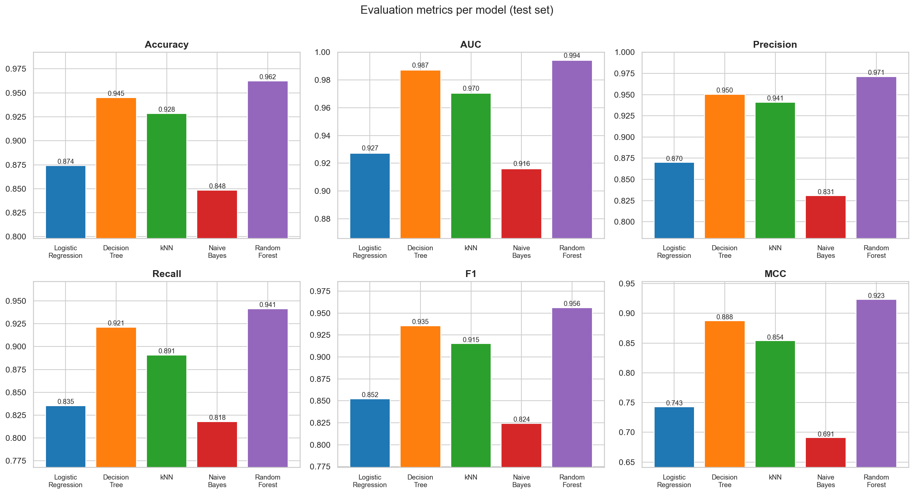
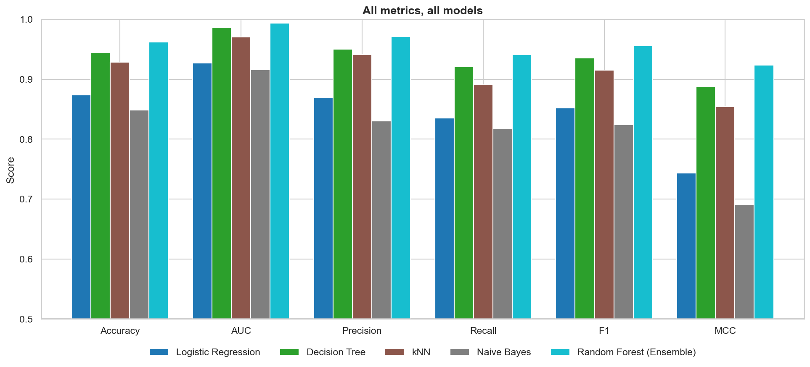
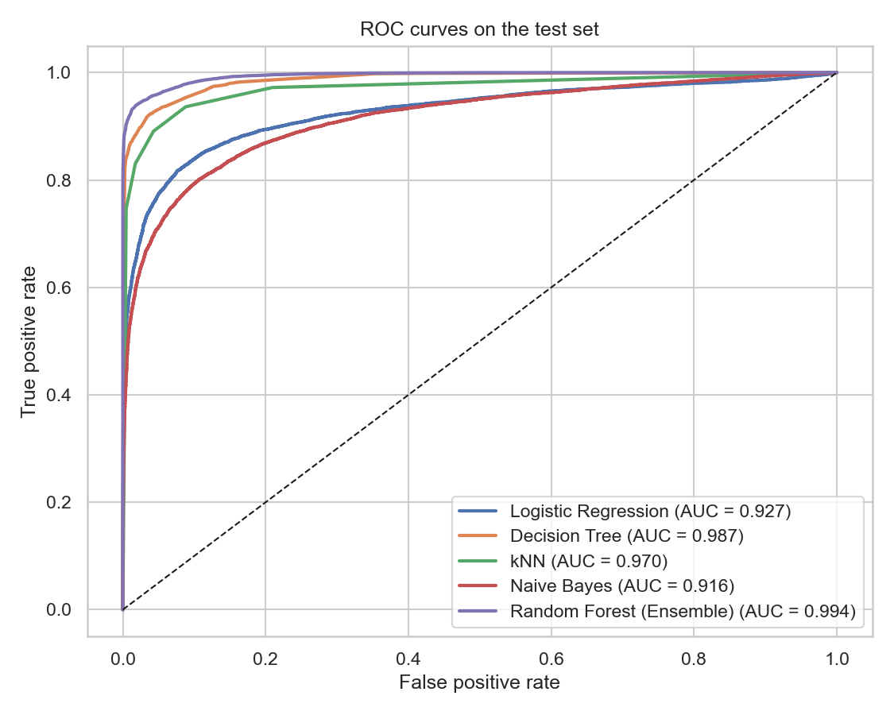
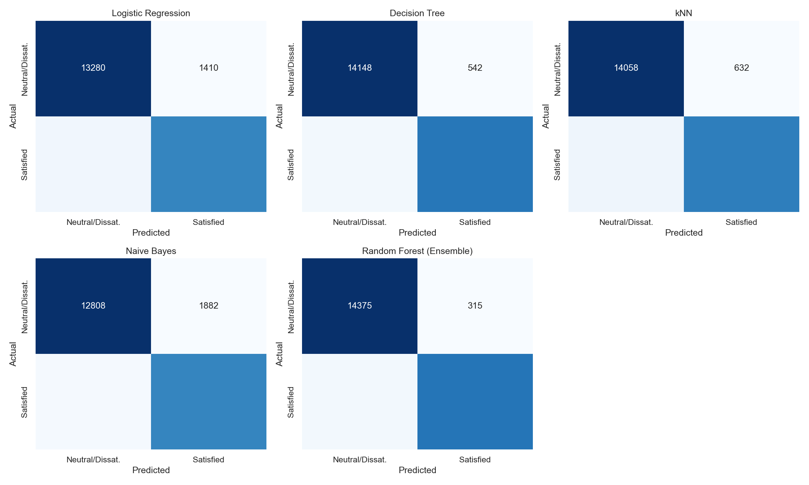
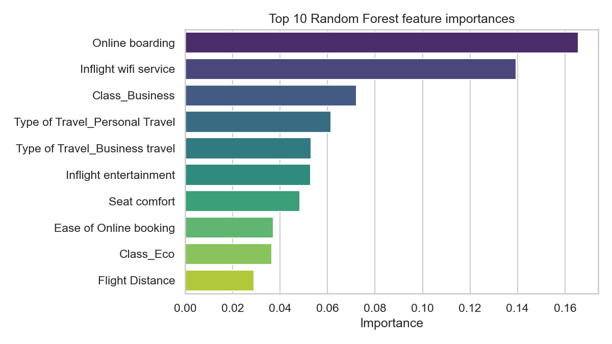

# Airline Passenger Satisfaction – Classification with 5 ML Models

## Name : Venkata Naga Ganesh Jujhavarapu
## Roll No : 2026CT05172

## 1. Problem Statement

The objective of this project is to predict whether an airline passenger is satisfied or neutral/dissatisfied based on passenger information, flight details, and service ratings.

Five machine learning classification algorithms are implemented and evaluated on the same dataset:

1. Logistic Regression
2. Decision Tree
3. K-Nearest Neighbors (KNN)
4. Gaussian Naive Bayes
5. Random Forest

The models are compared using six evaluation metrics: Accuracy, AUC, Precision, Recall, F1-Score, and Matthews Correlation Coefficient (MCC).

## 2. Dataset Description

- **Dataset:** Airline Passenger Satisfaction
- **Source:** [Kaggle – Airline Passenger Satisfaction](https://www.kaggle.com/datasets/teejmahal20/airline-passenger-satisfaction)
- **Dataset Author:** TJ Klein
- **Total Records:** 129,880 (103,904 training records and 25,976 test records)
- **Input Features:** 22 features after removing `Unnamed: 0` and `id`
- **Target Variable:** `satisfaction`

### Target Variable Encoding

- Satisfied = 1
- Neutral or Dissatisfied = 0

### Feature Information

The dataset contains:
- 4 categorical features: Gender, Customer Type, Type of Travel, and Class.
- 14 ordinal service-rating features.
- 4 continuous numerical features: Age, Flight Distance, Departure Delay, and Arrival Delay.

### Data Quality and Class Distribution

- **Class distribution:** 56.55% neutral/dissatisfied and 43.45% satisfied.
- **Missing values:** 393 missing values in `Arrival Delay in Minutes`.
- **Duplicate records:** 0.

The dataset has a mild class imbalance, which was examined before model training.

### Data Preprocessing

The following preprocessing steps were performed:

1. Removed unnecessary columns (`Unnamed: 0` and `id`).
2. Checked and handled missing values using median imputation for numerical data.
3. Checked for duplicate records.
4. Applied one-hot encoding to categorical features.
5. Applied StandardScaler to numerical features.
6. Performed an 80:20 stratified train-test split.
7. Used a fixed random seed of 42 to ensure reproducibility.

Preprocessing was implemented using Scikit-learn pipelines to ensure that transformations were fitted only on the training data and then applied to the test data.

The `test_data.csv` file contains the raw 20% hold-out test dataset (25,976 records), before preprocessing. It retains the original missing values, which are handled by the saved model pipelines.

## 3. GitHub Repository

**Repository Link:**  
https://github.com/2026ct05172-jvnganesh/ML_assignment_2_2026CT05172

The repository contains the complete implementation, dataset files, trained model pipelines, visualisations, requirements file, and test dataset.

## 4. Model Performance Comparison

All five machine learning algorithms were evaluated using the same 20% hold-out test dataset containing 25,976 records.

### Evaluation Metrics

| ML Model | Accuracy | AUC | Precision | Recall | F1-Score | MCC |
|---|---:|---:|---:|---:|---:|---:|
| Logistic Regression | 0.8741 | 0.9272 | 0.8699 | 0.8352 | 0.8522 | 0.7431 |
| Decision Tree | 0.9448 | 0.9870 | 0.9504 | 0.9211 | 0.9355 | 0.8877 |
| KNN | 0.9282 | 0.9703 | 0.9409 | 0.8907 | 0.9151 | 0.8539 |
| Gaussian Naive Bayes | 0.8484 | 0.9159 | 0.8306 | 0.8179 | 0.8242 | 0.6911 |
| Random Forest | **0.9623** | **0.9940** | **0.9712** | **0.9413** | **0.9560** | **0.9235** |

### Model Configurations

| Model | Configuration |
|---|---|
| Logistic Regression | max_iter = 1000 |
| Decision Tree | max_depth = 10, min_samples_leaf = 5 |
| KNN | n_neighbors = 5 |
| Gaussian Naive Bayes | Default parameters |
| Random Forest | n_estimators = 200 |

Random seed: 42.

### Performance Visualisations

The following visualisations provide a comparison of model performance and classification results.

**1. Evaluation Metrics Comparison**



**2. Grouped Model Performance Comparison**



**3. ROC Curve Comparison**



**4. Confusion Matrices**



**5. Random Forest Feature Importance**



## 5. Observations and Model Analysis

| ML Model | Observations |
|---|---|
| Logistic Regression | Provides a useful baseline and is computationally efficient. However, its linear decision boundary may not capture complex relationships between passenger ratings and travel characteristics. |
| Decision Tree | Captures non-linear relationships and provides interpretable decision rules. It achieves strong performance but can be less stable than ensemble methods. |
| KNN | Performs well after feature scaling. However, its recall is lower than the tree-based models, and prediction can be computationally expensive on larger datasets. |
| Gaussian Naive Bayes | Records the lowest performance among the five models. Correlations between service-rating features may affect its conditional independence assumption. |
| Random Forest | Achieves the best performance across all six evaluation metrics. Combining 200 decision trees helps improve predictive performance and reduce variance. |

### Overall Best Performing Model

**Random Forest is the overall winner.**

It achieved:

- Accuracy: 96.23%
- AUC: 99.40%
- Precision: 97.12%
- Recall: 94.13%
- F1-Score: 95.60%
- MCC: 92.35%

The feature importance analysis identifies online boarding, inflight Wi-Fi service, class, and type of travel among the important predictive features.

Based on the evaluation results, Random Forest provides the strongest overall classification performance for this dataset.

## 6. How to Run the Project

### Requirements

Python 3 and the libraries listed in `requirements.txt` are required.

### Installation

Clone the repository:

```bash
git clone https://github.com/2026ct05172-jvnganesh/ML_assignment_2_2026CT05172.git
cd ML_assignment_2_2026CT05172
```

Install the dependencies:

```bash
pip install -r requirements.txt
```

Launch Jupyter Notebook from the repository root:

```bash
jupyter notebook
```

Open:

`model/ML_Assignment_2_2026CT05172_Airline_Satisfaction.ipynb`

Ensure the notebook reads the dataset files from `Airline_satisfaction_Dataset/` using paths relative to the repository root:

```python
train = pd.read_csv("Airline_satisfaction_Dataset/train.csv")
test = pd.read_csv("Airline_satisfaction_Dataset/test.csv")
```

Run the notebook cells in sequence.

The notebook implements preprocessing, model training, evaluation, and visualisation.

### Saved Model Files

The five trained model pipelines are available in the `model/` directory as `.joblib` files. Each saved pipeline includes the preprocessing and trained estimator.

## 7. Repository Structure

```text
ML_assignment_2_2026CT05172/
│
├── README.md
├── requirements.txt
├── test_data.csv
│
├── Airline_satisfaction_Dataset/
│   ├── train.csv
│   └── test.csv
│
├── images/
│   ├── confusion_matrices.png
│   ├── metrics_bar_charts.png
│   ├── metrics_grouped.png
│   ├── rf_feature_importance.png
│   └── roc_curves.png
│
└── model/
    ├── ML_Assignment_2_2026CT05172_Airline_Satisfaction.ipynb
    ├── decision_tree.joblib
    ├── knn.joblib
    ├── logistic_regression.joblib
    ├── naive_bayes.joblib
    └── random_forest.joblib
```

## 8. Conclusion

This project demonstrates the implementation and evaluation of five machine learning classification algorithms for predicting airline passenger satisfaction.

All models were trained and evaluated using a consistent preprocessing workflow and the same stratified train-test split. Based on Accuracy, AUC, Precision, Recall, F1-Score, and MCC, Random Forest achieved the best overall performance.

The results demonstrate the effectiveness of ensemble learning for identifying patterns in passenger satisfaction data.
